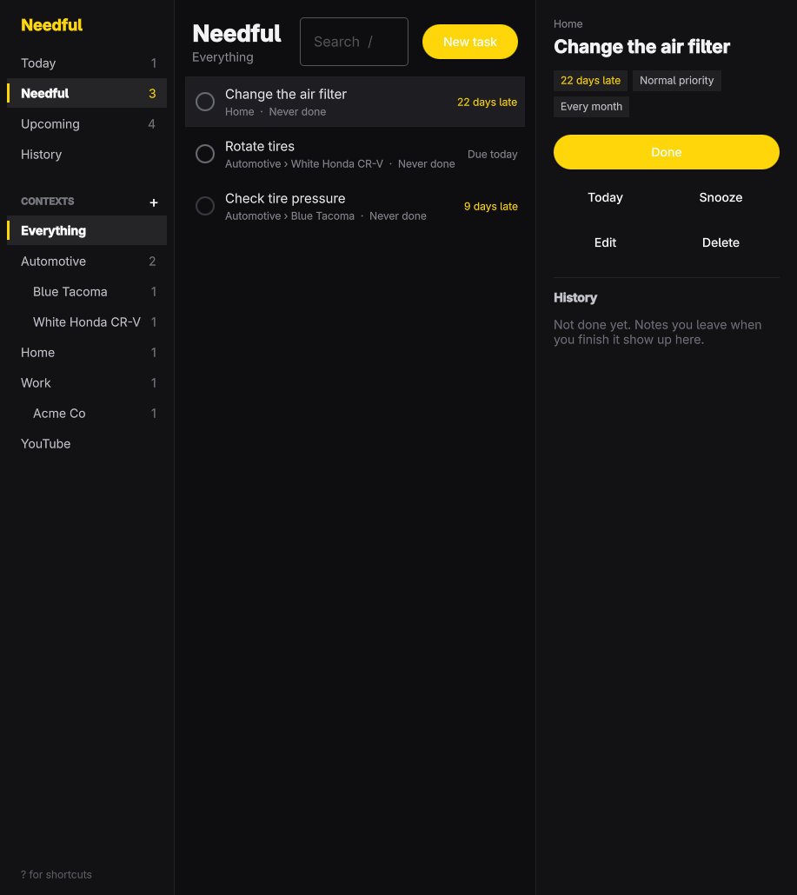

# Needful



A to-do list that can't pile up. Needful holds the routine things that keep a
life running (mowing, air filters, oil changes, invoices, the next video) and,
whenever you have a moment, shows you a short list ranked by how needful each
one is. Pick from the top, and trust that nothing is forgotten.

- **Needfulness** is priority, grown by how late a task is in units of its own
  rhythm. A weekly chore a week late counts as much as a monthly one a month
  late, so a high-priority mow wins on Saturday while the neglected air filter
  climbs steadily until it wins too.
- **Contexts** group tasks by where you do them: Home, Automotive › White
  Honda CR-V, Work › a client, YouTube. Contexts nest, and picking one filters
  every list to it and everything inside it.
- **Routines** share one task across several contexts: tick all three vehicles
  on "Oil change" and each gets its own copy, with its own due date, snooze,
  and history. Edits to the routine reach every copy, and a copy can keep its
  own schedule, priority, season, and notes ("Only Tacoma" in the editor).
- **Today** is the day's inbox. Pull tasks into it with `T`; it starts clean
  every morning, and what's done shows below, crossed off.
- **Snooze** hides a task for a while without pretending it's done.
- **Skip** passes over one time of a task (it rained, the car was away) and
  moves it on to the next, with why kept in its history.
- **Schedules** repeat from when you did it, on a fixed rhythm however late,
  ask you when to come back each time you finish, or happen once. A task can
  be in season only some months; the time out of season doesn't count as late.
- **History** keeps every completion with its note, under its context, so at
  the car you can see when the oil was last changed and with what.
- **Notes** (`L`) log anything you notice on a context, like a squeak at low
  speed, interleaved with that context's history. Mark one to follow up and
  it becomes a one-time task in that context, ranked with everything else.

## Keys

| Key | Does |
| --- | --- |
| `Space` | Done, with a note |
| `T` | Pull into today, or put back |
| `S` | Snooze |
| `Shift+S` | Skip this time, with why |
| `N` | New task |
| `L` | Log a note on a context, optionally to follow up |
| `E` / `Enter` | Edit |
| `X` / `Delete` | Delete (history stays) |
| `J` / `K`, `↓` / `↑` | Next / previous |
| `1` – `4` | Today, Needful, Upcoming, History |
| `[` / `]` | Previous / next context |
| `0` | Every context |
| `U` | Next universe |
| `C` | New context inside the current one |
| `Shift+C` | New top-level context |
| `/` | Search |
| `Ctrl+Z` / `Ctrl+Shift+Z` | Undo / redo |
| `?` | Show the shortcuts |
| `Q` / `Ctrl+Q` | Quit |

## Command line

Every command needs no display, takes `--json`, and exits 0 or 1:

```sh
needful list [--view needful|today|upcoming|all] [--context "Automotive/White Honda CR-V"]
needful add "Change the air filter" --context Home --every 1m
needful add "Mow the lawn" --context Home --every 1w --priority high --months 4-10
needful add "Oil change" --context CR-V --context Tacoma --context Civic --every 6m
needful done 3 --note "Mobil 1 5W-20, 84,210 mi"
needful skip 5 --reason "Rained all weekend"
needful log "Squeak from the front left at low speed" --context CR-V --follow-up
needful history --context "White Honda CR-V" --search oil
needful contexts add "Automotive/White Honda CR-V"
needful skill install   # teaches coding agents to use it
```

## Data

Everything lives in one JSON file in the platform's app data folder
(`~/.local/share/needful/needful.json` on Linux, inside the sandbox under
Flatpak, `~/Library/Application Support/needful` on macOS). `NEEDFUL_DATA` or
`--data` points it elsewhere. Every change saves at once, atomically, with the
previous version kept beside it as `needful.json.bak`. The window notices when
the command line changes the file, and every change is applied on top of
whatever another process saved, never over it.

## On your other computers

Pair your computers once, by a code, and they keep each other in step with
nothing in between: no account and no sync tool. Only a relay that passes along
traffic it can't read helps them find each other across networks; see below.

```sh
needful sync pair                            # on the desktop: shows a code
needful sync join 7-violet-crumble-tango     # on the laptop: joins its list
```

```
$ needful sync pair
Pair code: 7-violet-crumble-tango
This machine: "desktop"  4F2A-91C0-7B3E
Waiting for a computer… (the code works once, for a few minutes)
                                          $ needful sync join 7-violet-crumble-tango
                                          Pair with "desktop"  4F2A-91C0-7B3E? [y/N] y
Paired with "laptop"  C81D-0A47-E2F9      Paired with "desktop".
                                          Joined its list. Merged 3 tasks that were only here.
                                          This machine is "laptop".
```

Both show the same fingerprint, so you can check you paired with your own
machine. A code that's mistyped, used twice, or more than five minutes old
pairs nothing. The window has the same steps in the sidebar's ⋯ menu: Pair a
computer, Join a computer, and Unpair.

Joining takes in the other computer's list and merges in what only this one
had, so nothing is doubled. Universes come along too: every universe on one
of your computers shows up on the others (`universe remove` hides one on just
that computer). Pairing a computer with any one of yours trusts it on all of
them, and unpairing it on one unpairs it everywhere.

On the same network, paired computers find each other with nothing to set
up. Away from home, they meet at a relay and then connect directly whenever they
can: at the address one was last seen at, one you give it, or one they work
out through the relay. Needful listens on port 7787 (UDP, and TCP for pairing
with `--at`).

The relay is iroh's public one, run by [n0](https://n0.computer), until you
choose another. It only passes along encrypted traffic it can't read, and
stays out of the way once two computers have a direct path. Because of it, a
pairing code carries where to find the computer that shows it, so it's long
and meant to be copied, and it works from any network, like a laptop on a
phone's hotspot and a desktop at home:

```sh
needful sync pair                                # shows 7-violet-crumble-tango.<…>
needful sync join '7-violet-crumble-tango.<…>'   # on the laptop, wherever it is
```

Use a relay you run instead, or none, with `sync relay`; every paired computer
follows the latest choice. With none, codes are just the words, and computers
pair on the same network or with `--at`. The public relay is a stopgap: see
[docs/roadmap.md](docs/roadmap.md).

```sh
needful sync status                          # who's connected, and each one's last change
needful sync join <code> --at desktop.example.net   # pair across networks
needful sync reach desktop desktop.example.net      # look for it there too
needful sync relay https://relay.example.net        # meet through an iroh-relay you run
needful sync relay off                              # no relay: only direct connections
needful sync relay public                           # back to iroh's public relay
needful sync unpair old-mac                  # it can no longer connect; its changes stay
needful sync rename laptop
needful sync install                         # keep the link up with the window closed
```

```
$ needful sync status
This     laptop  C81D-0A47-E2F9
desktop  connected on this network · last change 4 minutes ago
nas      connected directly · last change just now
old-mac  not reachable since Tuesday · last change 2026-10-02
```

Changes pass between paired computers whenever two of them are awake: while
the window is open, while `needful serve` runs, or all the time with `sync
install` (needful-link.service on Linux, a launchd agent on macOS). Each
passes along everything it has, so run `sync install` on one always-on
computer, like a desktop, and it carries the laptop's changes to your
other computers even after every window is closed, and even if they're
never on at once; `sync uninstall` stops it. The relay passes along traffic it
can't read, and every paired computer learns of a change to it. The link is encrypted
end to end, and each computer only talks to computers it has paired with.

What may come later for pairing and sync is in [docs/roadmap.md](docs/roadmap.md).

### Through a sync folder

Or point Needful at a folder that a sync tool you already use (Syncthing,
Dropbox, iCloud Drive, Nextcloud) keeps in step, once on each computer:

```sh
needful sync setup ~/Sync/needful    # the first moves its data in
needful sync setup ~/Sync/needful    # the others join, merging in what only they had
needful sync status                  # when each machine's changes were last seen
needful sync forget old-thinkpad     # stop listing a machine you retired; its changes stay
```

A computer can sync through a folder, through its paired computers, or
both, and each keeps its list wherever it likes. One that syncs through a
folder can join another computer's list: the list moves into that folder and
reaches the machines sharing it too. Pairing two computers that already share
a folder loses nothing.

No sync tool? Any two computers that can reach each other over SSH can swap
changes with plain rsync. After `sync setup` on both, run this on one of
them:

```sh
needful sync rsync install desktop   # as ssh knows it; swaps every 5 minutes
needful sync rsync uninstall
```

It swaps once right away, so a missing SSH key shows up then and not in a
log, then installs a systemd user timer (a launchd agent in
`~/Library/LaunchAgents` on macOS, logging to `~/Library/Logs/needful-rsync.log`).
On macOS it uses Homebrew's rsync when there is one, and otherwise the system's
older `openrsync`, which works the same here. It needs a key that works without
a prompt (`ssh -o BatchMode=yes desktop true`). `--remote-folder` names the
folder there if it isn't at the same path, and `--every 30s|5m|1h` sets how
often.

### How the merge works

Every machine keeps working fully, online or not, and the open window takes
in the other machines' changes as they arrive. Each machine writes only its
own file, so no file ever has two versions to choose between; every machine
merges them all the same way. Different changes are all kept; the same field
edited on two machines goes to the later edit, by when it was made; a task
done on both the same day is one completion with both notes; a deleted task
stays deleted. The data file then only says which folder to use (for paired
computers with no sync folder, one Needful keeps beside it), and the single
file it held is kept beside it as `needful.json.before-sync`. Copy the
folder to keep a backup.

The data file itself has to stay on its own computer. If yours is in a
shared folder (the old way of syncing), setup says so and asks you to move
it first, and a data file that a sync tool copied from another computer is
refused rather than used.

## Other people's lists

A universe is a separate list on the same computer: your partner's, or one
for the house. Yours is always there and is what everything opens on;
others are one click away in the sidebar (or `U`), so their chores never
mix into your day.

In the window, add one from the sidebar's ⋯ menu (New universe…) or the
`+` beside the universes, giving it a sync folder if it should have one.
Right-click a universe to remove it. From the command line:

```sh
needful universe add hers ~/Sync/needful-hers   # join her synced folder
needful universe add house ~/Sync/needful-house
needful universe add scratch                     # a list kept only on this computer
needful universe                                 # mine, hers, house, scratch
needful list --universe hers                     # any command takes --universe
needful open --universe hers
needful universe remove scratch                  # stops listing it; its data stays
```

Each universe syncs through its own folder, the same way as your own, and
this computer joins it as one more machine. Your paired computers also keep
every universe in step among themselves. There are no permissions inside
a universe: anyone who has joined it can change anything in it.

## On your phone

`needful serve` runs a small web version for the phone: Today, Needful,
Upcoming, and History by context, marking things done with a note, pulling
into today, snoozing, logging a note, and quick tasks. It installs to the home
screen as an app. It listens on 127.0.0.1:8787 only, and has no password, so
Tailscale is how it reaches the phone.

Keep it running as a systemd user service, with a Tailscale node of its own
named `needful` (a userspace `tailscaled`, separate from the system's, so this
machine's identity on the tailnet doesn't change):

```sh
needful serve install --tailscale
systemctl --user daemon-reload
systemctl --user enable --now needful-serve.service needful-tailscale.service
needful serve login     # once: open the link it prints to add the node
needful serve status    # http://127.0.0.1:8787/ and https://needful.<tailnet>.ts.net/
```

On macOS the same command installs launchd agents in `~/Library/LaunchAgents`
(`kjlape.needful.serve`, plus `.tailscale` with `--tailscale`),
loads them straight away, and they start again at every login. There is no
`systemctl` step; `--tailscale` needs `brew install tailscale`. Logs are in
`~/Library/Logs/needful-serve.log`. The agent runs the binary where it was
when you installed, so install from `/Applications/Needful.app` (run
`/Applications/Needful.app/Contents/MacOS/needful serve install`), and run it
again if you move the app.

The tailnet needs MagicDNS and HTTPS certificates turned on (Tailscale admin
console, DNS). Without `--tailscale`, only the first service is installed, and
the page stays on this machine. `needful serve uninstall` stops and removes
the services.

Another universe gets a page of its own beside yours: `needful serve install
--universe hers [--tailscale]` installs `needful-serve-hers.service` on the
next free port (and a `needful-hers` node), and `login`, `status`, and
`uninstall` take `--universe` too.

## Build

```sh
bin/build     # build/needful
bin/test      # the tests, offscreen
bin/install   # an Arch package, so it shows up in the app launcher
```

Building needs Rust's `cargo` as well as Qt: the link between paired
computers (`link/`) is a small Rust library on [iroh](https://iroh.computer),
with iroh's address lookup turned off and a single relay: n0's public one unless you set another.

Needful is C++ and Qt Quick with no platform-specific dependencies: no D-Bus,
no portals, and the Omarchy theme and language are followed when present and
fall back cleanly when not, which keeps Flatpak and macOS builds open.

### macOS

You need Xcode's command line tools, Qt 6 (the [online
installer](https://www.qt.io/download-qt-installer-oss) puts it in
`~/Qt/<version>/macos`, and the script finds it there), and librsvg for the
icon (`brew install librsvg`). Then:

```sh
bin/build-macos
```

That builds `build/macos/Needful.app` and `build/macos/Needful-<version>.dmg`,
with the app icon, the Qt frameworks bundled, and an ad hoc signature. Open the
dmg and drag Needful to Applications. It isn't notarized, so on another Mac
the first launch needs right-click, then Open.

Double-clicking opens the window. The command line is the same program:

```sh
/Applications/Needful.app/Contents/MacOS/needful list
sudo ln -s /Applications/Needful.app/Contents/MacOS/needful /usr/local/bin/needful   # optional
```

`bin/build` and `bin/install` are for Linux. To run the tests on a Mac:

```sh
mkdir -p build/tests && cd build/tests
qmake6 ../../tests/needful_tests.pro && make -j"$(sysctl -n hw.ncpu)"
QT_QPA_PLATFORM=offscreen ./needful_tests.app/Contents/MacOS/needful_tests
```

How the package is put together, and how Linux services map to launchd, is in
[docs/building-for-macos.md](docs/building-for-macos.md).

## Next

- Meter triggers: log a vehicle's odometer, and the oil change falls due at a
  mileage.
- Translations: every string goes through `qsTr`/`tr`; catalogs go in
  `src/i18n/`.

## License

MIT. See [LICENSE](LICENSE).
